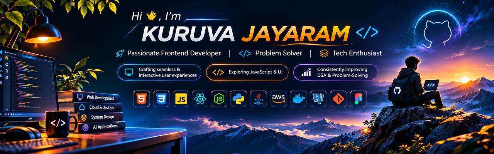

<div align="center">



<br/>

<a href="https://git.io/typing-svg">
  
</a>

<p>
<a href="https://linkedin.com/in/jaya-ram-774646314"></a>
<a href="https://github.com/jayaram5685"></a>
<a href="https://leetcode.com/jayaram_5685"></a>
<a href="https://www.hackerrank.com/kuruvajayaram3"></a>
</p>


</div>

---

## 👨‍💻 About Me

```yaml
name: Kuruva Jayaram
role: Software Engineering Intern | Full-Stack Developer
education: B.Tech Computer Science & Engineering
graduation: 2027
interests:
  - Full-Stack Engineering
  - AWS Cloud & DevOps
  - AI-Powered Applications
  - Backend Systems & System Design
  - Data Structures & Problem Solving
currently_building: ATMA (AWSBot)
```

I'm a final-year Computer Science student passionate about building useful software and understanding how applications work end to end — from frontend experiences and backend APIs to databases, cloud infrastructure, and deployment.

- 🔭 Working on **ATMA (AWSBot)** — a multi-tenant, AWS-native AI chatbot platform.
- ☁️ Exploring **AWS, Terraform, Docker, CI/CD, and cloud-native architecture**.
- 🧠 Strengthening my foundations in **DSA, DBMS, Operating Systems, and Computer Networks**.
- 🛠️ Interested in building reliable, scalable, user-focused applications.
- 🎯 Focused on continuous learning and growing as a software engineer.

---

## 🧑‍💻 Tech Stack

<div align="center">

### Languages


### Frontend


### Backend & Databases


### Cloud, DevOps & Tools


</div>

---

## 💼 Experience

### Software Engineering Intern — ASHTek Minds
*July 2026 – Present*

- Contributing to software engineering work in a remote internship environment.
- Working through implementation, debugging, and collaborative development workflows.
- Developing practical experience with modern application engineering.

### Earlier Experience

- **Full-Stack Developer Intern** — Unified Mentor
- **Python Development Intern** — Zaalima Development
- **Teaching Assistant** — NxtWave

---

## 🚀 Featured Projects

### 01. ATMA (AWSBot) — Multi-Tenant AI Chatbot Platform

An AWS-native conversational platform designed for clinic workflows.

- Worked on multi-tenant architecture with tenant-level data isolation.
- Built backend functionality using **Node.js and Express**, alongside a **React** administration experience.
- Integrated **Amazon Bedrock** for RAG and tool-calling workflows.
- Worked on appointment workflows, slot validation, and email notifications using **Amazon SES**.
- Contributed to WebSocket-based live-agent handover.
- Helped migrate the data layer from **Amazon DynamoDB to PostgreSQL**.
- Authored **Terraform** infrastructure for AWS resources including S3 and CloudFront.

`Node.js` `Express` `React` `PostgreSQL` `Amazon Bedrock` `Amazon SES` `AWS` `Terraform` `WebSockets`

### 02. AI-Powered Personal Finance Manager

A full-stack application for tracking and understanding personal finances.

- Developed backend APIs with Node.js and Express.
- Used MongoDB for persistence and JWT for authentication.
- Built the frontend using React.
- Worked with Vercel and Render deployment.

`React` `Node.js` `Express` `MongoDB` `JWT`

### 03. Dockerized Web Server

A practical project exploring containerized web deployment.

- Practiced packaging and running a web server with Docker.
- Explored Linux-based server configuration and deployment fundamentals.

`Docker` `Linux` `Web Server`

<div align="center">

<a href="https://github.com/jayaram5685?tab=repositories">

</a>

</div>

---

## 🏅 Certifications

<div align="center">

| Certification | Issuer |
|:--|:--|
| AWS Certified Cloud Practitioner | Amazon Web Services |
| Oracle Cloud Infrastructure 2025 Certified Foundations Associate | Oracle |

</div>

---

## 📈 GitHub Statistics

<div align="center">


<br/>


<br/>


</div>

---

## 🧩 Problem Solving

I continuously improve my programming fundamentals through regular practice and problem-solving.

<div align="center">

<a href="https://leetcode.com/jayaram_5685">

</a>

<a href="https://www.hackerrank.com/kuruvajayaram3">

</a>

</div>

---

## 🤝 Let's Connect

<div align="center">

<a href="https://skillicons.dev">

</a>

<br/><br/>

**LinkedIn:** [Jayaram](https://linkedin.com/in/jaya-ram-774646314)

**GitHub:** [@jayaram5685](https://github.com/jayaram5685)

**LeetCode:** [jayaram_5685](https://leetcode.com/jayaram_5685)

**HackerRank:** [kuruvajayaram3](https://www.hackerrank.com/kuruvajayaram3)

**Instagram:** [@__jai__56_](https://instagram.com/__jai__56_)

</div>

---

<div align="center">

### ⚡ Learn Continuously · Build Thoughtfully · Deploy Confidently

*Thanks for visiting my GitHub profile!*

</div>
